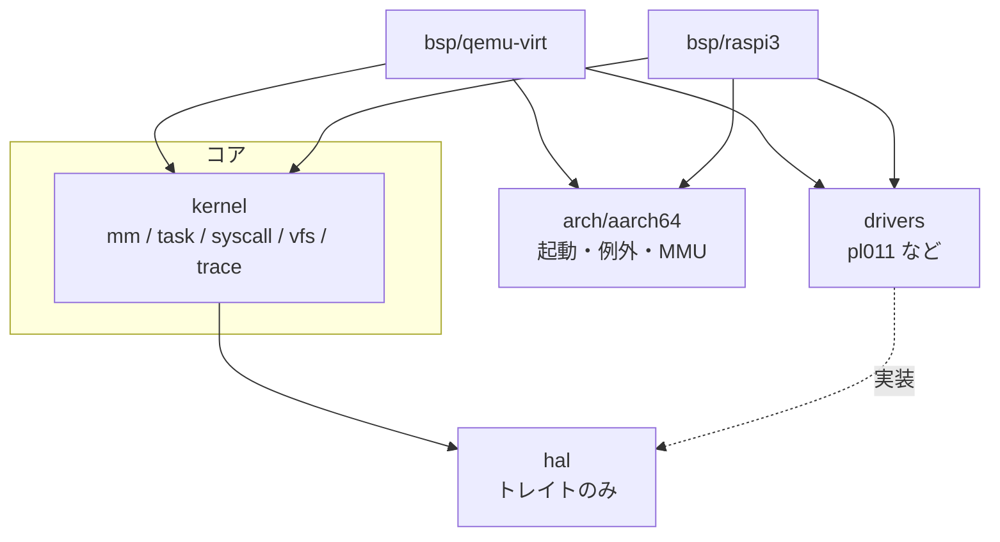

# アーキテクチャ

ポート&アダプター構成。コアは `hal` のトレイト(ポート)にだけ依存し、ハードウェアの知識はアダプター(ドライバ)と配線(BSP)に閉じ込める。

## ポート一覧

| ポート(`hal`) | 役割 | 実装 |
| --- | --- | --- |
| `console::Console` | バイト列の出力 | `Pl011`、`MockConsole`(テスト)、`SemihostingConsole`(QEMU のテスト) |
| `irq::IrqController` | 割り込みの有効化、番号の取得、終了の通知 | `GicV2`、`LocalIntc` |
| `timer::Timer` | カウンタと、一定時間後の割り込み | `GenericTimer` |
| `mmio::Mmio` | レジスタの読み書き(ドライバが使う) | `MmioRegion`(実機)、`FakeMmio`(テスト) |

ポートやクレートを足したら、この表と図を更新する。

## クレートとビルド先

| クレート | ホスト(`cargo test`) | `aarch64-unknown-none` |
| --- | --- | --- |
| `hal` | ○ | ○ |
| `kernel` | ○ | ○ |
| `pl011`(`drivers/pl011`) | ○ | ○ |
| `gicv2`(`drivers/gicv2`) | ○ | ○ |
| `bcm2836-local-intc`(`drivers/bcm2836-local-intc`) | ○ | ○ |
| `xtask` | ○ | × |
| `arch-aarch64` | ○(純粋な部分だけ) | ○ |
| `ktest` | × | ○(カーネル内テストの枠組み) |
| `bsp-qemu-virt` | × | ○(QEMU `-M virt` で起動するイメージ) |
| `bsp-raspi3` | × | ○(QEMU `-M raspi3b` と実機のイメージ、`kernel8.img`) |
